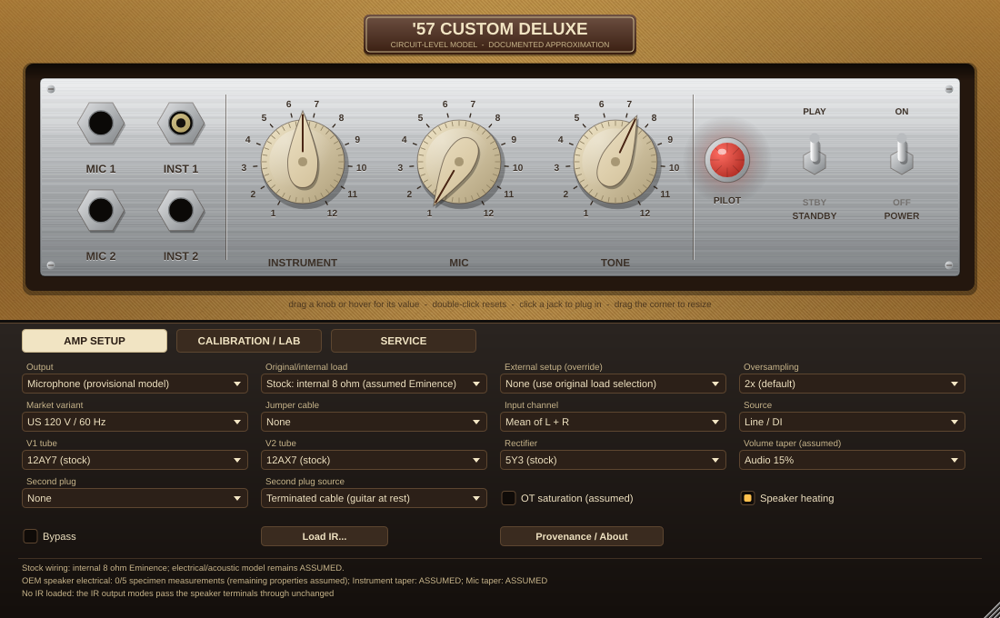

# '57 Custom Deluxe — circuit-level amplifier model (VST3 + Standalone)

A digital recreation of the modern Fender '57 Custom Deluxe (PR 728 / 815050 family), built **at the circuit level** from the public-source
engineering dossier (`Fender '57 Custom Deluxe — Public-source Engineering Dossier`, Edition 1). Every stage is solved as part of one
interacting nonlinear electrical system (modified nodal analysis) — not as a chain of EQ + waveshaper blocks.

> **Honest status.** This is a *documented approximation* of the modern amplifier: the historical 5E3-family topology with modern nominal
> values, transcribed from the dossier's schematic (Fig. 7) and checked against it by an independent re-transcription, with tube laws fitted to
> the dossier's own manufacturer curve sheets. The dossier itself says (pp. 1, 2, 62) that no specimen was measured and that a one-to-one
> claim cannot be made from documents alone, and this project follows that rule. Every parameter carries an evidence label; assumptions carry
> sensitivity intervals; `docs/DOSSIER_COMPLIANCE.md` lists what was audited, what was fixed and what could not be; `docs/TRACEABILITY.md` lists
> every number that does **not** come from the dossier. What a real unit would add (specimen schematic, measured pots, transformers, speaker,
> cabinet, microphone chain) is listed in the dossier's missing-data ledger and cannot be replaced by code.

## Hardware-fidelity updates (6 November 2026)

This update addresses the **high/medium-priority** modern-control and speaker-loading gaps without disguising unknown hardware characteristics as measurements:

* **Standby:** The plugin has independent, automatable **POWER** and **STANDBY** switches. Both must be ON for normal operation. STANDBY removes the modeled high-voltage excitation and lets supply capacitors discharge while mains phase and simulated heater/rectifier emission stay active. Leaving standby restores power without cold tube warm-up. **The actual switching point in the modern Fender wiring has not been established**; the implemented HV gate is a documented *behavioral approximation*, not a verified modern schematic. Fender recommends leaving the amplifier in STANDBY for its first 60 seconds after turning POWER on. Existing presets default the newly added switch to ON.
* **Speaker jacks:** The existing five-choice speaker-load parameter is **designed to retain** indices **0–4** and their original normalized automation positions (for DAW preset compatibility), and flags the older internal-plus-extension choice as **experimental/not recommended by Fender**. A separate **External speaker wiring** selector offers single external **8 Ω** or dual external **16 Ω** arrangements without resizing the legacy automation parameter. Bench-only resistive dummy modes remain labelled as such. External speakers use **nominal resistive proxies**, not measured driver/cabinet models; choose a correctly captured user IR for corresponding acoustic output.
* **OEM Eminence speaker:** The default `Re`/`Le`/`fs`/`Qms`/`Qes`/`Mms`/`Sd` values remain *assumed*. `scripts/fit_speaker_impedance.py` now fits identifiable *linear electrical* parameters from a calibrated, small-signal, **free-air complex-impedance** CSV, with specimen provenance, held-out error checks, and optional independent repeat capture. `docs/SPEAKER_CALIBRATION.md` gives the protocol. A sweep cannot identify independent moving mass, cone area, displacement nonlinearities, cabinet response, or a microphone IR.
* **Modern volume tapers:** Fender advertises improved tapers on both channels without publishing resistance-versus-rotation data. `scripts/fit_pot_tapers.py` converts measured eleven-position wiper resistances to separate Instrument/Mic specimen-delta maps (see `docs/POT_CALIBRATION.md`); the plugin reports **MEASURED** or **ASSUMED** per channel. The selected audio-taper fallback remains an assumption until a real unit is measured. The engine still uses one shared *total* pot resistance; the importer retains separately measured totals as provenance but cannot automatically apply unequal totals without a further circuit change.

Fender sources: [official modern owner's manual](https://www.fmicassets.com/Damroot/Original/10001/%2757%20Custom%20Deluxe%20manual%20MULTI%207708607000a.pdf) (standby and speaker-jack warnings), [official product specifications](https://www.fender.com/products/57-custom-deluxe) (special-design 12-inch alnico and revised tapers). See [`docs/HARDWARE_ROUTE.md`](docs/HARDWARE_ROUTE.md) for the measurement-to-build workflow and [`docs/IMPLEMENTATION_AUDIT_2026-11-06.md`](docs/IMPLEMENTATION_AUDIT_2026-11-06.md) for claim boundaries.

## Editor



A top-down "lacquered tweed" front panel, drawn procedurally in `plugin/PluginEditor.cpp` (original artwork; no manufacturer images, logos or fonts): chrome control plate with cream pointer knobs (value bubble on hover/drag, double-click resets to the default), jewel pilot that follows the modelled lamp, clickable input jacks, PLAY/STANDBY and POWER switches. Secondary settings sit in a tabbed lower strip (Amp setup / Calibration & lab / Service with live circuit state and scope). The window is resizable (70–150 %, fixed aspect). `cd57_editor_snapshot` (CTest `plugin_editor_snapshot`) renders the editor offscreen at several sizes.

## What is modelled

| Dossier subsystem | Implementation |
|---|---|
| Jack network, plug states (§06) | Four explicit jack sockets with switching jacks, guitar plug selectable per jack, a **second plug** (a second guitar on the right input channel, or a cable terminated in the source impedance) in any other jack, optional **jumper cable** between any two jacks. The 1 MΩ / 136 kΩ input impedances and the −6 dB of input 2 are **reproduced by the circuit** (not fitted); with a terminated plug in the other jack of a channel the circuit gives −6.02 dB and 119.7 kΩ (1 MΩ ‖ 136 kΩ), as the drawing's 68 kΩ network predicts (`validate_jacks`). |
| First stage (§07) | 12AY7 pair with **shared cathode** (820 Ω ∥ 25 µF) so the channels couple through cathode voltage; electrode capacitances between real nodes. |
| Volumes + tone (§08) | Coupled passive network: two volume pots (wiper fed from the plate coupling caps), tone pot with the 500 pF bright path and 5 nF shunt, the **silent channel still loads the driven one**. Pots are two resistances joined at the wiper with a documented endpoint contact resistance. Modern taper numerics remain unknown → assumed and selectable, but measured specimen maps can override **each channel independently**. |
| Gain stage + cathodyne (§09) | 12AX7 stage and bootstrapped cathodyne (1 MΩ returns to the 1.5 kΩ / 56 kΩ junction), coupling-capacitor charge state. |
| Output stage (§10) | Two 6V6 models with plate, **screen and grid current**, shared-cathode bias dynamics, blocking distortion through the coupling-capacitor / grid-current path. |
| Supply (§11) | Explicit 5Y3 rectifier conduction, transformer series resistance, three 16 µF filter nodes (5 kΩ, 22 kΩ): sag, ripple, rail interaction; 50/60 Hz market variants. Separate power and **provisional HV-gating standby** states retain heater warmth and electrical capacitor discharge. |
| Output transformer (§12) | Centre-tapped primary, winding resistance, leakage inductance and a flux-state core. **Linear by default**; an assumed saturating law is an explicit option (the dossier says not to assign one before evidence exists). |
| Speaker (§17–18) | Electromechanical equivalent (Re, Le, motional RLC from T/S) inside the circuit so the amp sees a **complex load**; voice-coil heating raises Re (not in dummy/external-proxy modes, where the internal coil is disconnected). Its default values are unmeasured assumptions; a free-air complex-impedance fitter can supply specimen-specific linear values. |
| Speaker jacks (modern manual) | Original five-choice speaker-load automation **retained by design** (host regression pending); separate external-wiring selector provides single external 8 Ω or two external 16 Ω as **nominal electrical proxies**. The saved historical internal-plus-extension option remains accessible but is flagged as *not recommended by Fender*. |
| Acoustics (§18–19, 27) | **Provisional** cone-velocity → microphone operator. A measured voltage→mic IR can replace it (route 1), or be factored onto the model's own cone motion (route 2, "hybrid") so cone motion and heating stay in the loop without counting the cone twice. Gain, polarity and arrival time of the IR are preserved. |
| Calibration (§24) | Physical volts at the jack and at the speaker terminals; input calibration is a control; the jack voltage is limited to the 30 V peak the solver is validated for. |
| Numerics (§21, 23) | Modified nodal analysis, θ-method companions, Newton with line search that accepts a step only if the nodal KCL residual is small too, adaptive sub-step fallback with counters, half-band oversampling (1/2/4/8×) with exact whole-sample latency, no heap allocation in the audio path, circuit state kept across blocks and across an oversampling change. |

## How the tube models were obtained

The four JJ characteristic sheets in the dossier (12AY7, ECC83S, 6V6S, 5Y3S) were **digitised at pixel level** (`scripts/digitize_jj_sheets.py`: calibrated
axes with sub-pixel grid fitting, printed-grid removal, ridge tracing of every curve, overlay images for visual verification), then fitted with a global
optimiser (`scripts/fit_tubes.py`) and validated on whole held-out curves and across panels, as the dossier's §16 requires.
Results: 12AY7 5.1 % and 12AX7 4.8 % relative error in the operating region; 6V6 7.1 % in the amplifier's region (19.5 % with a positive grid) — the sheet is
triode-connected, so the screen partition and Early voltage come from an external RCA rating point that is labelled as such. The JJ sheets describe JJ
tubes, not necessarily Fender's stock tubes (the dossier says so too).

## Build

Requirements: CMake ≥ 3.22, a C++17 compiler. JUCE 8.0.15 is fetched automatically (or pass `-DCD57_JUCE_DIR=/path/to/JUCE`). Python 3 with numpy and scipy is
optional (needed for the independent re-implementation test, speaker-impedance fit and for re-running the digitiser/tube fitter). The measured-pot importer uses Python's standard library.

```bash
# Linux system packages for JUCE
sudo apt-get install -y build-essential cmake ninja-build pkg-config libasound2-dev libx11-dev libxrandr-dev libxinerama-dev \
    libxcursor-dev libxext-dev libfreetype-dev libfontconfig1-dev libgl1-mesa-dev libcurl4-openssl-dev
```

```bash
cmake -S . -B build -G Ninja -DCMAKE_BUILD_TYPE=Release
cmake --build build --target CustomDeluxe57_VST3 CustomDeluxe57_Standalone
```

Artefacts: `build/CustomDeluxe57_artefacts/Release/VST3/57 Custom Deluxe.vst3` and `.../Standalone/57 Custom Deluxe`.
Copy the `.vst3` bundle to `~/.vst3` (Linux), `%COMMONPROGRAMFILES%\VST3` (Windows) or `/Library/Audio/Plug-Ins/VST3` (macOS).
GitHub Actions (`.github/workflows/build.yml`) builds all three platforms and runs the test suite; only the **Linux** build was run and tested during development.

## Using it

* **Input:** the plugin takes a mono guitar signal (plus an optional second plug, below). *Input channel* chooses the mean of L and R (a dual-mono source stays at its calibrated level), left only or right only.
  *Input Calibration* sets the volts at the jack for a 0 dBFS sample (default 1.0 V peak; with *Input trim* ±12 dB the jack never sees more than 20 V): the dossier stresses that this must be calibrated to your interface — it is a control, not a Fender number.
* **Panel:** Instrument Volume, Mic Volume, Tone (printed 0–12 scale — an assumption), separate **POWER** and **STANDBY** switches, four jacks laid out as photographed (MIC | INST, rows 1 and 2; click to plug the guitar in), jumper cable, pilot jewel. STANDBY is an electrical supply-state behavior, not merely an output mute. The modern physical switch contact placement is unverified.
* **Second plug** (lab area): *Second plug* puts a second cable in another jack (a jack holds one plug; the same jack as the guitar is ignored); *Second plug source* is either a **terminated cable** (a guitar at rest: the plug, its switching and its source impedance are in the circuit, the signal is not) or the **right input channel** (a second guitar; the first source is then the left channel alone). This reproduces the §06 rows "both jacks of one channel" and "one input per channel".
* **Output:** *Microphone (provisional model)* · *Speaker terminals* (calibrated volts, 0 dBFS = 28.28 V peak, rated 12.5 W sine = −6 dBFS) · *User IR* (voltage→mic capture, route 1) · *User IR on cone motion (hybrid)* (route 2).
* **Speaker load:** The original selector retains internal 8 Ω (nominal assumed OEM), experimental internal + 8 Ω extension (**Fender does not recommend**), and explicitly labelled bench dummy loads. The independent **External speaker wiring** selector overrides the effective DSP load with single external 8 Ω (supported connection, resistive electrical proxy) or two external 16 Ω (supported connection, two parallel nominal resistors). This is **intended to avoid changing** the legacy speaker-load parameter's normalized automation scale; verify saved-host sessions against the plugin regression suite. External proxies do **not** simulate the external speakers' acoustics; a user IR is required for that.
* **Service panel** shows live rail voltages (B+1/2/3), 6V6 cathode voltage, voice-coil heating, solver iterations/fallbacks and CPU.
* **Lab controls:** market variant (50/60 Hz and nominal volts from the manual's table), line voltage %, V1/V2 tube swap, silicon rectifier, source model (line/DI or passive pickup + cable), volume taper, output-transformer saturation option, oversampling, specimen-variation seed, hum and noise (seeded; the noise-free circuit stays independently testable).
* **Latency** is reported to the host and is exact and rate-dependent. At 2× (default): 79 / 45 / 13 samples at 44.1 / 48 / 96 kHz; 4×: 87 / 52 / 19; 8×: 90 / 55 / 21; 1×: 0.
* Changing the oversampling factor **keeps the circuit state** (rails, capacitor charge, transformer flux, coil temperature): the new engine adopts it, its up-sampler is primed with recent input, and the old engine is cross-faded out over 512 samples.

**CPU** (one core of a shared cloud container, 512-sample blocks at 48 kHz, heavy drive with control automation, `validate_realtime`): mean / p99.9 of the real-time budget —
1×: 40 % / 112 %, **2× (default): 47 % / 95 %**, 4×: 68 % / 131 %, 8×: 116 % / 273 %. 8× is therefore labelled *offline*. Timings are reported, not gated, because shared runners are noisy.

## Validation

`ctest --test-dir build` registers **19 tests** (18 without the plugin, when Python with NumPy/SciPy is available; the Python-dependent tests are skipped if prerequisites are missing). Each reports PASS / FAIL against a criterion fixed in advance, and INFO for numbers that are only recorded.

| Suite | What it establishes | Report |
|---|---|---|
| `dossier_validation` (`cd57_validate`) | everything in dossier §26–27 that does not need a physical amplifier: input impedances, DC point and KCL, control interactions, AC-vs-transient at the operating rates, rated power as a **calibration residual**, harmonics, burst recovery by lock-in, supply ripple, block-size independence | `docs/VALIDATION_REPORT.md`, `docs/NETLIST.md` |
| `netlist_vs_schematic_register` (+ self-test) | the netlist equals an independent re-transcription of Fig. 7 at graph level (14 injected faults all caught) | `docs/SCHEMATIC_TRANSCRIPTION.md` |
| `independent_reimplementation` | a Python implementation sharing no code with `src/dsp` (own parser, stamps, device equations, DC and AC solves) agrees with the C++ solver: DC within 0.24 V, AC within 0.0013 dB / 0.002° | `scripts/independent_check.py` |
| `tube_device_laws` | analytic Jacobians vs finite differences, C¹ continuity, signs, and that the C++ laws reproduce every digitised sheet point | `tools/validate_tubes.cpp` |
| `supply_regulation_vs_jj_5y3s` | the rectifier law in a simulated capacitor-input supply vs the JJ regulation curves: droop within 7 %, constant offset reported | `tools/validate_supply.cpp` |
| `numerics_validation` | aliasing and integration error vs a 16× reference, resampler specification, step-size convergence, assembled Jacobian, KCL along a transient, charge conservation, **whole-amplifier energy balance (0.000 %)** | `docs/NUMERICS_REPORT.md` |
| `realtime_robustness` | zero heap allocation (operator new counted) in steady state and across every control/config change, NaN/Inf and over-range input, Newton acceptance, load modes, linear OT default, state transfer, per-block timing | `tools/validate_realtime.cpp` |
| `acoustic_validation` | the Sec. 27 linear-acoustic identity (route 1 vs route 2) with a **synthetic** H, IR gain/polarity/arrival time, resampling, dipole algebra | `tools/validate_acoustic.cpp` |
| `plugin_processor` | the built plugin's processor driven directly: reported latency, input-channel choice, the second plug (a right-channel signal reaches the amplifier only through a driven second plug), acoustic modes and IR state, hybrid vs route 1, continuity across an oversampling swap | `tests/ProcessorTest.cpp` |
| `metrics_selftest` | the dossier §26 metrics (NRMSE / ESR, fixed-delay estimate, sweep response / phase / group delay, Farina harmonic orders, harmonics, two onset definitions, IMD, burst envelope and recovery) against **analytic answers** — 34 checks | `src/analysis/Metrics.h`, `tools/validate_metrics.cpp` |
| `jack_states_two_plugs` | the four-jack, two-plug model against closed-form predictions of the drawing's grid network (−6.02 dB, 119.7 kΩ, no change from a plug in the other channel, linear superposition of two driven plugs, collision rules) | `tools/validate_jacks.cpp` |
| `manifest_provenance_and_specimen_delta` | schema-2 provenance on every parameter; the all-null specimen template changes nothing (bit-identical render); a measured value sits beside the nominal one; every refusal (unknown key, unit mismatch, no instrument, no date, other base profile, bad branch); measured pot maps override the assumed taper per pot | `tools/validate_manifest.cpp` |
| `speaker_impedance_fit_selftest` | **Synthetic** complex-impedance fit/refusal tests, held-out error, specimen-delta/provenance output and input/output safety; tests do **not** establish OEM speaker accuracy | `scripts/test_fit_speaker_impedance.py`, `docs/SPEAKER_CALIBRATION.md` |
| `pot_taper_fit_selftest` | **Synthetic** per-channel resistance-map conversion, delta compatibility, endpoint/monotonicity/provenance checks and malformed-capture refusal; tests do **not** establish Fender taper accuracy | `scripts/test_fit_pot_tapers.py`, `docs/POT_CALIBRATION.md` |
| `capture_matrix_quick` / `capture_compare_selfcheck` | the §25 capture programme renders, its §30 metadata validates against the schema and reproduces the committed reference; the §26 comparison scores identical renders as exactly zero, **fails** a perturbed model, and passes 1x vs 2x oversampling | `scripts/check_capture_matrix.py`, `scripts/check_compare.py` |
| `valve_conduction_consistency` / `sensitivity_quick` | the per-valve current report is consistent with the circuit (mean cathode current x 250 Ω = mean cathode voltage at every drive level); the sensitivity study's direction, isolation and degenerate-range self-checks | `tools/cd57_conduction.cpp`, `tools/cd57_sensitivity.cpp` |

Also: `cd57_host_test` loads the built VST3 through JUCE's VST3 host (`xvfb-run` on Linux); `cd57_render` is an offline WAV→WAV renderer.

**Measurement harness (dossier §24–26, 30).** `cd57_capture_matrix` renders the §25 capture programme (4 inputs × 27 knob combinations × clean / onset / driven = 324 captures, + 72 endpoint, 33 jack-state, 36 held-out) with the §30 minimum capture
metadata; `cd57_compare` scores any two capture directories — the model against a hardware recording of the same programme, or against itself — with the §26 metrics and limits; `cd57_manifest` validates and merges specimen deltas;
`cd57_conduction`, `cd57_sensitivity` and `cd57_diagnostics` produce the per-valve conduction report, the §13 sensitivity ranking and the §26 diagnostic views (`docs/CONDUCTION_REPORT.md`, `docs/SENSITIVITY_REPORT.md`,
`docs/DIAGNOSTICS.md`, `docs/figures/`). The route from this approximation to a measured match, step by step: **`docs/HARDWARE_ROUTE.md`**.

**Not evaluated (needs reference hardware):** magnitude/phase/harmonic/IMD/recovery agreement with a real unit, speaker impedance and nonlinear isolation, microphone chain,
blind listening, the capture programme. The 12.5 W / <5 % THD figure is a **calibration** of the unknown power-transformer voltage, not independent evidence; the validation
report publishes how weakly it constrains that value. The dossier's −80 dBFS alias candidate limit is met for a heavy six-note chord at 2× but not for a heavy single
3.1 kHz tone below 8× (solver truncation dominates; `docs/NUMERICS_REPORT.md` section F shows that tightening the Newton tolerances 10⁴× changes that residual by 0.06 dB, i.e. it is time-step truncation, so only smaller steps or a more accurate integrator would lower it).

## Provenance and how to refine the model

* `data/netlist/cd57_nominal.net` — readable, versioned netlist; each element has an evidence tag (`CONF`/`HIST`/`ASSUMED`/`DATASHEET`/`PROP`) and source id. `data/netlist/schematic_register.json` is the independent transcription it is checked against.
* `data/parameters/cd57_nominal.json` — the §30 manifest (59 entries, schema 2: every entry carries status, branch, source revision, serial range and uncertainty; the loader refuses entries without them, an assumed value without an interval, and fails on a missing requested key). 20 entries drive the model (including the output transformer and the pot maps); the rest document values that live elsewhere (listed in the validation report).
* `data/parameters/specimen_delta_template.json` + `cd57_manifest merge` — measurements enter as a **versioned specimen delta** merged *beside* the nominal values (never replacing them), with unit, instrument/date and identifiable specimen mandatory for measured values; measured Instrument/Mic maps replace the assumed taper independently. Use the two measured-data importers above to generate deltas from raw sweeps or wiper-resistance samples.
* `data/capture/capture_metadata.schema.json`, `data/calibration/`, `data/reference/` — the §30 capture-metadata schema, the model's boundary calibration and a hardware calibration template, and the committed regression references (capture matrix, conduction, sensitivity).
* `docs/SOURCE_CATALOGUE.md` — the 32 sources of the dossier: what each is used for, whether this implementation could read it (only the dossier itself and its embedded figures), and where it enters the repository.
* `data/tubes/digitized/` + `scripts/` — the digitised JJ sheets with overlay images, the digitiser, the fitter and `generated/TubeFits.h`. Re-run: `python3 scripts/digitize_jj_sheets.py && python3 scripts/fit_tubes.py && python3 scripts/make_manifest.py`.
* To adopt measurements: write a specimen delta (`data/parameters/specimen_delta_template.json`), `cd57_manifest merge`, render with `--manifest merged.json` or build with `-DCD57_MANIFEST=merged.json`, re-calibrate the power-transformer value only if you did not measure it (`cd57_validate --calibrate-pt`), run the suites. For structural changes edit the netlist and `scripts/make_manifest.py` (keep the evidence label).
  After changing the netlist **topology**, run `cmake --build build --target regen_lu_kernel` (a pattern-signature check falls back to the generic solver if you forget — slower, never wrong).

## Limitations (please read)

* Transformer, speaker, pot-taper, cabinet and supply values are **assumptions** until measured (`assumed`/`unknown` in the manifest). The power-transformer voltage is **calibrated** to the documented 12.5 W / <5 % THD.
* The JJ sheets describe JJ tubes; the 6V6 sheet is triode-connected, so pentode-mode behaviour rests partly on one external RCA rating point (labelled **EXTERNAL** in `docs/TRACEABILITY.md`). Tube fits are 5–7 % in the operating region and worse with a positive grid or near cut-off.
* The modern amplifier's exact service schematic was not available; the historical 5E3 topology is used with the modern nominal values (dossier §04). The one value conflict between the dossier text (0.022 µF) and the drawing (.02) is documented; the dossier's value is used.
* The dossier's cited primary sources (owner's manual, the earlier service drawing, RCA/other datasheets, the Mercury transformer sheet, Koren, ...) could not be fetched from the build environment (outbound access to those hosts is denied). Only the dossier's own text and embedded figures were used. The earlier service drawing's test-point voltages, the RCA 6V6/5Y3 curves and the manual's speaker-jack rules would each tighten the model if they were supplied.
* Acoustic output is a physics-based **provisional** operator, not PN 7708599000 in its cabinet; load a measured voltage→mic IR for a specific sound. The 5.2 kHz cone roll-off may overlap what the voice-coil inductance already does; that cannot be decided without data.
* Large-signal speaker nonlinearity (Bl(x), Kms(x)) is not modelled (no data); startup is initialized at a modeled electrical state rather than a validated 60-second physical tube-warm-up trace. POWER ramps the modeled supply and heaters; separate STANDBY gates HV while keeping emission warm (exact modern contact placement unknown).
* Mono output (one amplifier, one speaker-terminal signal; at most two input sources); Windows/macOS builds are CI-only and untested here. Latency changes of the hosted VST3 reach a host through the host's own latency-change mechanism.

## Licensing and trademarks

Built on [JUCE 8](https://juce.com) (AGPLv3 / commercial licence): distributing a build of this plugin requires complying with JUCE's licence — **no licence file is included; the repository owner has to choose one accordingly.**
"Fender", "Deluxe" and model names are trademarks of their owners; this is an independent educational model, not affiliated with or endorsed by them. No Fender artwork or logo is used.
No Fender photograph is included. **`data/tubes/source_images/` holds the four JJ Electronic characteristic sheets exactly as embedded in the dossier (the digitiser re-runs from them), and the overlay PNGs in `data/tubes/digitized/overlays/` draw the traced curves on top of them.** They are third-party manufacturer material kept for fitting and verification; the repository owner should confirm that redistributing them is acceptable or delete both directories (the digitised CSVs, the fit and every test work without them at run time; only re-running the digitiser needs the images).
